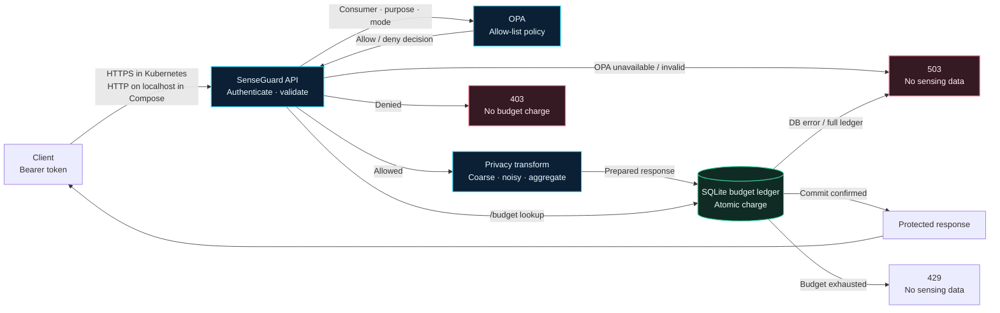
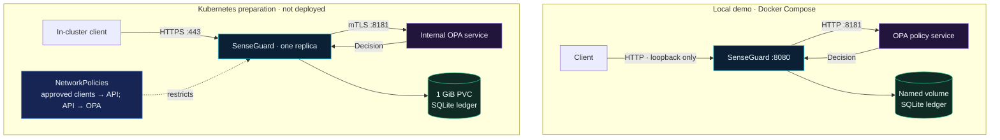
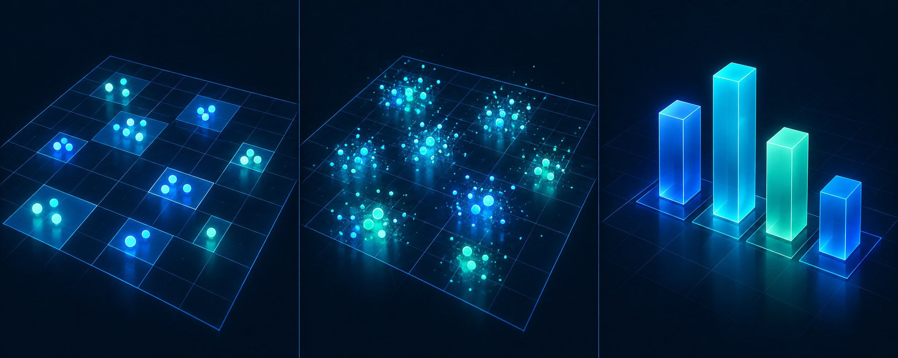

<p align="center">
  
</p>

<h1 align="center">SenseGuard</h1>
<p align="center"><strong>Privacy-aware release for simulated 6G sensing data</strong><br />Policy-gated · Identity-bound · Budget-accounted</p>

<p align="center"><a href="SECURITY_PRIVACY_REVIEW.md">Security review</a> · <a href="VERIFICATION_REPORT.md">Verification report</a> · <a href="DEPLOYMENT_CHECKLIST.md">Deployment checklist</a></p>

<p align="center">
  
  
  
  
</p>

SenseGuard is a small Go API that authenticates consumers, asks Open Policy Agent (OPA) to evaluate each purpose and privacy mode, transforms simulated sensing data, then charges a per-consumer SQLite budget before returning it.

> **Prototype:** simulated data only. SenseGuard is not production-ready and does not provide formal differential privacy.

## Request architecture



Authorization happens before any charge. The API returns sensing data only after SQLite confirms the budget transaction.

## Deployment profiles



Go handles HTTP, transformations, and the ledger. OPA evaluates `policy/senseguard.rego`. Compose is a localhost-only development profile; Kubernetes manifests are preparation only. SQLite is a single-replica ledger, not a shared multi-replica store.

## Privacy modes at a glance

<p align="center">
  
</p>

Coarse mode rounds coordinates and redacts IDs; noisy mode adds cryptographically randomized demonstration noise; aggregate mode returns type counts. These are teaching examples, not a differential-privacy guarantee.

## Configuration

| Variable | Default / container value | Purpose |
| --- | --- | --- |
| `OPA_URL` | http://localhost:8181 locally / https://opa:8181 in Kubernetes | OPA server |
| `DATABASE_PATH` | data/senseguard.db / /data/senseguard.db | SQLite file |
| `DEFAULT_PRIVACY_BUDGET` | 5 | Initial balance for a new consumer |
| `REQUEST_PRIVACY_COST` | 1 | Cost for each authorized data response |
| `COARSE_GRID_SIZE` | 10 | Coordinate rounding grid |
| `NOISE_SCALE` | 3 | Demonstration noise scale |
| `CONSUMER_TOKENS` | Required JSON object | Consumer ID to high-entropy bearer token map; keep in a secret store |
| `REQUIRE_TLS` | false locally / true in Kubernetes | Require HTTPS for API and OPA connections |
| `TLS_CERT_FILE`, `TLS_KEY_FILE` | unset locally / Secret mount in Kubernetes | API server TLS certificate and key |
| `OPA_CA_FILE` | unset locally / Secret mount in Kubernetes | Trusted OPA server CA |
| `OPA_CLIENT_CERT_FILE`, `OPA_CLIENT_KEY_FILE` | unset locally / Secret mount in Kubernetes | Client certificate for OPA mutual TLS |

Invalid or non-positive numeric environment values use defaults. `REQUIRE_TLS` accepts only `true` or `false`; any other value stops startup. When `REQUIRE_TLS=true`, the API requires TLS certificate/key files and OPA requires HTTPS, a trusted CA, and a client certificate/key. If any OPA TLS file is configured, `OPA_URL` must use HTTPS; partial client-certificate pairs are rejected at startup. The service exits at startup if `CONSUMER_TOKENS` is missing or malformed. Tokens must be unique and at least 32 characters; generate them with a cryptographically secure random generator and distribute each token only to its consumer. The Kubernetes OPA policy also pins the mTLS client subject to `CN=senseguard-api` and permits only the allow-decision and health endpoints.

## Run directly with Go

This needs Go installed and OPA running. In a first PowerShell window, start OPA (the first run may download its official image):

```powershell
docker run --rm -p 127.0.0.1:8181:8181 --mount "type=bind,source=$($PWD.Path)\policy,target=/policy,readonly" openpolicyagent/opa:1.0.0 run --server --addr=0.0.0.0:8181 --diagnostic-addr=127.0.0.1:8282 /policy/senseguard.rego /policy/opa_authz.rego
```

In a second window, from the project directory:

```powershell
$env:OPA_URL = 'http://localhost:8181'
# Set CONSUMER_TOKENS to a JSON map from consumer ID to a unique random token.
# Keep this process environment private; never commit the value.
function New-ConsumerToken {
    $bytes = New-Object byte[] 32
    $generator = [Security.Cryptography.RandomNumberGenerator]::Create()
    try { $generator.GetBytes($bytes); [Convert]::ToBase64String($bytes) }
    finally { $generator.Dispose() }
}
$env:RESEARCHER_TOKEN = New-ConsumerToken
$env:MALL_MANAGER_TOKEN = New-ConsumerToken
$env:CONSUMER_TOKENS = @{ researcher = $env:RESEARCHER_TOKEN; 'mall-manager' = $env:MALL_MANAGER_TOKEN } | ConvertTo-Json -Compress
$env:DATABASE_PATH = Join-Path $PWD.Path 'data\senseguard.db'
go run ./cmd/senseguard
```

The default database path is already `data\senseguard.db`; setting it explicitly here shows how to configure it. The folder is created automatically.

## SQLite persistence

SQLite stores one balance per consumer in the `privacy_budgets` table. Each deduction is a transaction, and the existing balance is retained when the app restarts. The ledger refuses new consumers after 10,000 entries. Denied requests do not spend budget. If SQLite cannot confirm a charge, SenseGuard returns HTTP 503 without returning sensing data.

Compose uses a named volume called `senseguard-data` at `/data`. Recreating the app container preserves that volume. Never use `docker compose down -v` if you need to keep its data. Kubernetes uses a 1 GiB PersistentVolumeClaim and one SenseGuard replica. SQLite is not a shared multi-replica ledger.

Persistent storage is not a backup. Protect the volume and practice restoring backups.

## Run checks

Local Go checks use Go 1.26.9, the patched toolchain pinned by this repository. Direct Rego checks require OPA 1.0.0 or compatible OPA. Docker commands require Docker Desktop Engine access.

PowerShell commands from the project root:

```powershell
gofmt -w .\cmd\senseguard\*.go
go test ./cmd/senseguard/...
go test -race ./cmd/senseguard/...
go vet ./cmd/senseguard/...
go test -cover ./cmd/senseguard/...
go mod verify
go run golang.org/x/vuln/cmd/govulncheck@v1.1.4 ./cmd/senseguard/...
opa test policy/ -v
docker compose config --quiet
kubectl kustomize .
```

The release Go commands target `./cmd/senseguard/...` so they test the maintained application package only. A root-level `go test ./...` can also discover ignored historical audit copies; snapshots are not release source. Go tests use a mocked OPA server; `opa test` checks the actual Rego files. Compose config validation does not start services. `govulncheck` is the Go team's tool for checking known vulnerabilities in called code paths. The verification-only GitHub Actions workflow runs these checks, builds the image, and validates rendered Kubernetes resource schemas. It does not deploy or publish an image. Its first run is pending until GitHub executes it. If using Docker for Go/OPA checks, official images may be downloaded when missing. Read-only mount examples:

```powershell
docker run --rm --mount "type=bind,source=$($PWD.Path),target=/workspace,readonly" --workdir /workspace golang:1.26.9 go test ./cmd/senseguard/...
docker run --rm --mount "type=bind,source=$($PWD.Path),target=/workspace,readonly" --workdir /workspace golang:1.26.9 go vet ./cmd/senseguard/...
docker run --rm --mount "type=bind,source=$($PWD.Path)\policy,target=/policy,readonly" openpolicyagent/opa:1.0.0 test /policy -v
```

These need a working Docker engine and available images. Check `VERIFICATION_REPORT.md` for what actually ran.

## Start with Docker Compose

```powershell
function New-ConsumerToken {
    $bytes = New-Object byte[] 32
    $generator = [Security.Cryptography.RandomNumberGenerator]::Create()
    try { $generator.GetBytes($bytes); [Convert]::ToBase64String($bytes) }
    finally { $generator.Dispose() }
}
$env:RESEARCHER_TOKEN = New-ConsumerToken
$env:MALL_MANAGER_TOKEN = New-ConsumerToken
$env:CONSUMER_TOKENS = @{ researcher = $env:RESEARCHER_TOKEN; 'mall-manager' = $env:MALL_MANAGER_TOKEN } | ConvertTo-Json -Compress
docker compose up --build
```

This builds the API image, may download Go, Distroless, and OPA images, and starts both services. Both published ports bind to localhost. Stop with Ctrl+C, or use `docker compose stop` / `docker compose down` without `-v`.

Compose waits for an OPA health check that evaluates a known allowed decision, confirms the API authorization policy is loaded, and calls OPA's loopback-only diagnostic `/health` endpoint. The Compose OPA API uses plain HTTP inside the local network and does not authenticate API clients; this is a localhost-only development profile. SenseGuard `/readyz` separately checks SQLite and OPA `/health`; authorization errors fail closed. The Kubernetes profile configures HTTPS for the API and mutual TLS plus OPA API authorization for SenseGuard-to-OPA traffic. OPA permits the pinned `CN=senseguard-api` identity to query only the policy decision and health endpoint.

Health and readiness:

```powershell
Invoke-RestMethod http://localhost:8080/healthz
Invoke-RestMethod http://localhost:8080/readyz
```

`/healthz` checks that the HTTP process responds. `/readyz` checks both SQLite and OPA. The Docker image's built-in health check calls `/readyz`, so the container is healthy only when the service can reach both dependencies.

## Try the API and inspect a budget

**Local demonstration only:** Compose uses HTTP and binds to localhost, so do not expose it to an untrusted network. Both protected endpoints require a bearer token mapped to a consumer identity. Keep tokens private; the `X-Consumer-ID` header is not trusted and mismatched claims are rejected. Kubernetes enables HTTPS and mutual TLS to OPA.

Allowed coarse response:

```powershell
Invoke-RestMethod -Headers @{'Authorization'=('Bearer '+$env:RESEARCHER_TOKEN)} 'http://localhost:8080/sensing?purpose=crowd-analysis&mode=coarse'
```

Allowed aggregate response:

```powershell
Invoke-RestMethod -Headers @{'Authorization'=('Bearer '+$env:MALL_MANAGER_TOKEN)} 'http://localhost:8080/sensing?purpose=occupancy-monitoring&mode=aggregate'
```

Denied request (HTTP 403):

```powershell
try { Invoke-RestMethod -Headers @{'Authorization'=('Bearer '+$env:RESEARCHER_TOKEN)} 'http://localhost:8080/sensing?purpose=track-person&mode=coarse' } catch { $_.Exception.Response.StatusCode }
```

Budget lookup:

```powershell
Invoke-RestMethod -Headers @{'Authorization'=('Bearer '+$env:RESEARCHER_TOKEN)} 'http://localhost:8080/budget'
```

With the defaults, five successful requests use the five-unit budget; the next allowed request returns HTTP 429. A denied request does not charge.

## Check persistence after app-container recreation

Record a caller's current balance, recreate only the API container, then query again:

```powershell
docker compose up -d --force-recreate senseguard
Invoke-RestMethod -Headers @{'Authorization'=('Bearer '+$env:RESEARCHER_TOKEN)} 'http://localhost:8080/budget'
```

The named volume remains attached. Compare the balance before and after. This command has not been run as part of this verification.

## Back up the database

The application includes an online SQLite snapshot command. It uses SQLite `VACUUM INTO` to create a consistent snapshot while the API may be running, refuses to overwrite a destination, and verifies the new file's integrity and ledger schema. The destination directory must exist and be writable. See [SQLite VACUUM INTO](https://www.sqlite.org/lang_vacuum.html#vacuuminto) for the snapshot behavior.

```powershell
$backupName = 'senseguard-' + (Get-Date -Format 'yyyyMMdd-HHmmss-fffffff') + '.db'
$containerBackupPath = '/data/' + $backupName
docker compose exec senseguard /senseguard backup $containerBackupPath
if ($LASTEXITCODE -ne 0) { throw 'SQLite snapshot failed; keep the source database and inspect the error.' }
docker compose exec senseguard /senseguard verify-db $containerBackupPath
if ($LASTEXITCODE -ne 0) { throw 'Snapshot verification failed; do not use this backup.' }
$backupDir = Join-Path $PWD.Path ('backups\' + [IO.Path]::GetFileNameWithoutExtension($backupName))
if (Test-Path -LiteralPath $backupDir) { throw 'Backup export path already exists; refusing to overwrite it.' }
New-Item -ItemType Directory -Path $backupDir | Out-Null
$backupFile = Join-Path $backupDir $backupName
docker compose cp ("senseguard:/data/" + $backupName) $backupFile
if ($LASTEXITCODE -ne 0) { throw 'Could not export the snapshot to the protected host directory.' }
```

Keep backups protected and out of source control. The snapshot remains on the database volume until an operator-managed retention process removes it; export it promptly to storage independent from the source volume. Backups contain consumer IDs and budget balances. Restore only into a new, separate test database and verify it with `/senseguard verify-db <path>`; never overwrite the live database during a test. The command and isolated restore test do not provide backup scheduling, off-site retention, RPO/RTO, or a production recovery drill.

## Logs and troubleshooting

```powershell
docker compose logs --tail 100 senseguard
docker compose logs --tail 100 opa
```

Logs omit sensing coordinates/data and bearer tokens. They may include authenticated consumer IDs and purposes; avoid placing personal or sensitive values in those fields.

- `policy service unavailable` (503): OPA is unreachable, starting, or returned an invalid response.
- `privacy budget service unavailable` (503): check that the database volume is mounted and writable.
- `privacy budget exhausted` (429): the caller has no remaining balance.
- Docker named-pipe access denied: Docker may work in a regular terminal while this session cannot access its engine. Use an authorized Windows terminal; do not change pipe permissions casually.
- Build/pull errors: images or Go modules may need downloads. Confirm before allowing downloads.

## Kubernetes (preparation only)

Files in `k8s/` define the internal OPA and SenseGuard Deployments and Services, a 1 GiB PVC, and NetworkPolicies. Root `kustomization.yaml` generates the OPA ConfigMap directly from the tested files in `policy/`, keeping deployed policy in sync with source. Run `kubectl kustomize .` to render the full set. SenseGuard uses one replica, the DB at `/data/senseguard.db`, startup/readiness/liveness probes, resource requests/limits, and non-root controls. OPA remains ClusterIP/internal.

Create the namespace first, then create the required Secrets from protected files. The Kustomize set creates the ConfigMap and workloads. The Kubernetes profile expects these Secret names and keys:

```powershell
kubectl apply -f .\k8s\namespace.yaml
kubectl -n senseguard create secret tls senseguard-tls --cert=<api-cert.pem> --key=<api-key.pem>
kubectl -n senseguard create secret generic opa-server-tls --from-file=tls.crt=<opa-server-cert.pem> --from-file=tls.key=<opa-server-key.pem> --from-file=ca.crt=<opa-ca.pem>
kubectl -n senseguard create secret generic senseguard-to-opa-client --from-file=tls.crt=<client-cert.pem> --from-file=tls.key=<client-key.pem> --from-file=ca.crt=<opa-ca.pem>
kubectl -n senseguard create secret generic senseguard-consumer-credentials --from-file=tokens=<protected-token-map.json>
kubectl apply -k .
```

The API NetworkPolicy allows ingress only from pods labeled `senseguard.io/client=true` in namespaces labeled `senseguard.io/allow-senseguard=true`. Have the cluster operator apply the namespace label only to approved client namespaces and add the pod-template label to approved client workloads. For example, `kubectl label namespace <client-namespace> senseguard.io/allow-senseguard=true`; setting the pod label belongs in the reviewed client Deployment template. The policy is default-deny for other API callers and requires a CNI that enforces Kubernetes NetworkPolicy.

The OPA client certificate subject must be exactly `CN=senseguard-api`. The OPA server certificate must include `DNS:opa` and `DNS:opa.senseguard.svc`; the API certificate must match the DNS name used by its clients. Keep certificate private keys and token files outside the repository. `kubectl kustomize .` renders locally without contacting a cluster; the GitHub verification workflow performs schema validation, but cluster behavior still needs review against the target Kubernetes version.

The token-map JSON maps consumer IDs to unique random tokens of at least 32 characters. Configure Kubernetes Secret encryption at rest and least-privilege RBAC. These example commands are instructions only and have not been run.

The PVC leaves `storageClassName` unset, so the cluster needs a default dynamic StorageClass. The storage driver must support `fsGroup: 65532`. The app and OPA require externally created TLS Secrets and a consumer-credentials Secret; no secret material is included in this repository. OPA requires a client certificate and validates it against its configured CA. NetworkPolicies restrict OPA ingress to SenseGuard and API ingress to client pods labeled `senseguard.io/client=true` in namespaces labeled `senseguard.io/allow-senseguard=true`; enforcement depends on the CNI. Apply those labels only to reviewed client workloads. The app Service is ClusterIP-only. No ingress is configured.

Future commands only (**NOT EXECUTED**; they change a cluster):

```powershell
# After the namespace, ConfigMap, and required Secrets above exist:
kubectl apply -k .
kubectl -n senseguard rollout status deployment/opa
kubectl -n senseguard rollout status deployment/senseguard
kubectl -n senseguard port-forward svc/senseguard 8443:443
```

See `DEPLOYMENT_CHECKLIST.md` first. No Kubernetes deployment was performed.

## Privacy and security limitations

- `/sensing` and `/budget` require a bearer token mapped to a consumer identity at startup. `X-Consumer-ID` cannot establish identity; a mismatch is denied. Protect token delivery, storage, rotation, and revocation.
- SQLite transactions/mutex protect this single replica; they do not provide a shared budget across multiple app replicas.
- Budget units are per-request counters, not epsilon accounting.
- Coarse mode rounds coordinates and redacts IDs, but keeps object types and counts.
- Noisy mode samples Laplace-shaped demonstration noise with Go's cryptographically secure random source and fails closed if random generation fails. No sensitivity, neighboring-data model, or privacy accountant is defined, so this is not differential privacy.
- Aggregate counts can expose information about small groups.
- Use simulated data only. Formal privacy accounting, tested restore, cluster storage validation, monitoring, retention/log policies, and specialist security/privacy review remain required before production.

## Project map

- `cmd/senseguard/main.go`: API, authorization, transformations, startup/shutdown.
- `cmd/senseguard/ledger_sqlite.go`: SQLite schema and budget transactions.
- `cmd/senseguard/main_test.go`: API and persistence tests.
- `policy/`: OPA rules and tests.
- `Dockerfile`, `docker-compose.yml`: local container configuration.
- `k8s/`: cluster resources and persistent storage.
- `docs/assets/`: compressed README hero and privacy-mode illustrations.
- `DEPLOYMENT_CHECKLIST.md`, `SECURITY_PRIVACY_REVIEW.md`, `VERIFICATION_REPORT.md`: review material.
